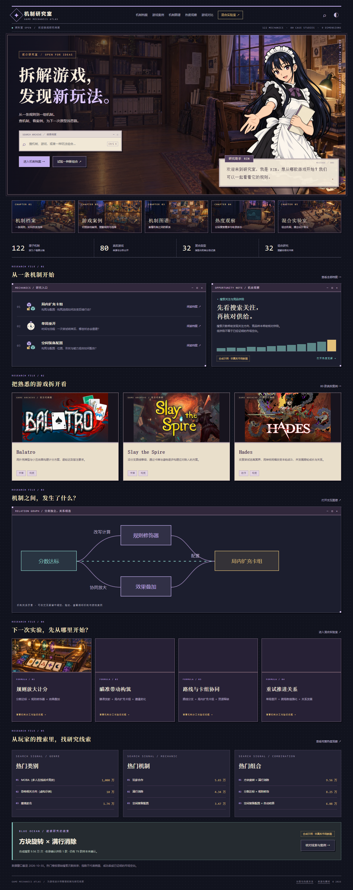

# 机制研究室 · Game Mechanics Atlas

面向游戏设计师的机制知识库、真实游戏案例、组合实验室与搜索需求观察平台。本地数据驱动，无需数据库、模型 API 或账号即可运行。

当前静态版收录 80 款游戏、122 条机制和 32 组配方，游戏卡面使用官方代表图。静态构建与本地验收已通过；GitHub Pages 因当前账号套餐不支持私有仓库而尚未上线。

[GitHub私有仓库](https://github.com/momowangOUO/game-mechanics-atlas) · [实际验收记录](docs/verification.md)



## Galgame 美术升级 · 2026-10-31

以下记录此前的美术制作阶段；其中 18 张游戏示意图现已归档，当前使用官方代表图，配方图已扩充至 32 张。

按「游戏艺术家」工作流完成研究室场景、独立前景、六种 RIN 角色状态、五张栏目插画、18张原创玩法示意、10张配方场景和九维图标。首页使用标题画面与角色对话；内页增加纸面档案、线索板和观察便签。实验室的机制卡、冲突标记、盖章与角色反应由实际操作驱动。

[目标与制作说明](docs/game-artist/upgrade.md) · [正式素材清单](docs/game-artist/assets.json) · [独立视觉评审](docs/game-artist/review.md) · [本轮验证](docs/game-artist/verification.md)

网站文案已按 clear-natural-writing 复核，覆盖界面、RIN 台词、知识条目与分析说明。[审校记录](docs/copy-review/summary.md) · [MP4 操作录屏](docs/game-artist/motion/research-session.mp4)

## 本地运行

需要 Node.js 22.13+（本机验证为 24.11.1）与 npm。

```sh
npm ci
npm run dev
```

打开 http://127.0.0.1:3000 。根路径静态构建与预览：

```sh
npm run build
npm start
```

## GitHub Pages 静态版

**本轮尚未上线：GitHub 实际返回当前套餐不支持此私有仓库的 Pages。源码继续保持私有；本地静态产物和发布工作流已完成。** [本轮完整验收](docs/static-expansion/verification.md)

网站已改为纯静态导出，部署内容位于 `out/`，无需 Node 服务或数据库。开发命令仍使用 Next；生产预览仅托管静态文件。

```sh
npm run build:pages
npm run preview:pages
```

访问 http://127.0.0.1:3000/game-mechanics-atlas/ 。根路径和项目子路径是不同构建配置，切换位置需要重新构建。`PAGES_BASE_PATH` 可覆盖构建路径。

[静态化实施说明](docs/static-pages-implementation.md) · [资料独立抽审](docs/static-expansion/content-review.md) · [图像与来源清单](src/data/game-art-sources.json)

源码仓库保持私有。Pages 工作流只发布 `out/`，由 `main` 推送或手动触发，没有定时研究或自动补资料任务。实际发布结果以本轮验收记录为准。

## 功能

|入口|用途|
|---|---|
|`/`|原创女仆引导、搜索、重点案例、组合与搜索关注概览|
|`/mechanics`|按维度、核心玩法与关键词检索，定义、边界、反例与相关案例|
|`/games`|真实游戏档案；机制、循环、关系与热度视图，模式范围切换|
|`/types`|传统复合类型与原子机制分开建模|
|`/graph`|拖动、平移、缩放、维度过滤、邻接关系、同范围共现与案例追踪|
|`/lab`|十组配方、自定义机制与目标、规则诊断、循环、冲突、Demo问题与相似案例|
|`/heat`|原始需求排行、需求供给散点、趋势、蓝海／红海线索、JSON导入导出|
|`/compare`|两款游戏与不同范围的机制、循环、构筑、资源和搜索关注对照|
|`/method`、`/sources`|分类约束、五状态、公式、数据格式、事实来源与资产边界|

全局搜索支持 Ctrl/Cmd K。手机使用底部导航、筛选抽屉、图表 Tab、排行分页与实验室分步操作。动效包含页面与面板转场、数字增长、关系路径、图谱邻接高亮、搜索展开和角色轻动效；系统减少动态偏好优先，自动模式同时照顾手机和低性能设备。

## 分类与内容

正式目录包含 **122 条原子机制、80 款游戏、32 个复合类型、32 组配方、120 条编辑关系、703 条机制实例和 146 个独立来源页面**。其中 702 条实例为存在或条件成立，另有 1 条既有反面观察。来源事实、社区资料、编辑分析分别标识；没有安装实测所有游戏，也没有对全部实例完成独立二次审计。

九维ID固定为 `interaction`、`rules`、`temporal`、`buildcraft`、`progression`、`economy`、`information`、`participants`、`variability`。机制实例只引用规范机制ID，不能复制并改写主维度。题材、画风、叙事和平台属于独立元数据；检索标签和复合类型不改变原子身份。

实例支持 `present / absent / not_applicable / unknown / conditional`，并绑定游戏、模式、系统、章节、角色或版本范围。未填写按未知查询；只有显式父子范围可以继承，兄弟范围不能拼接。条件实例需要写明成立条件。已记录实例是有来源的下界，不意味着其余机制不存在，也不是 80 款游戏的完整机制矩阵。

事实、编辑设计分析与未核验事项在页面分别说明。定义、机制组合、核心循环及实现难点是定性编辑归纳，不伪造精确工时、官方结论或已验证创新。

## 搜索需求与机会线索

当前 **5940条日聚合搜索记录、180天时间序列全部为合成示例**，演示截至2026-10-30的行为。主题由规范目录生成；具备种子记录的主题显示示例需求，其余保留未采集。页面、图表、导出记录均保留来源标记。

- 热门排行按归因搜索次数D，供给S是本站已确认的不同游戏数量。
- 原始总量每条记录只计一次；同一事件在不同主题种类中可以分别归因，同一种类权重总和不得超过1。
- 游戏名代理信号和直接机制搜索分开。搜索次数不是独立人数、销量或购买意愿。
- 组合供给要求原子机制在同一兼容范围共同存在；条件与未知单列，不跨模式凑组合。
- 同类主题比较：`d=√(D/Dmax)`、`c=S/(S+2)`；蓝海线索`100d(1−c)`，红海线索`100c(1−0.5d)`。公式版本`sample-heat-v1-k2`。
- 零供给不直接判蓝海；完全未记录不同于实测零；趋势要求前后等长区间逐日、来源和归因口径可比。上一期为零时用状态表达，不计算无穷增长。

热度页可以校验并替换本地JSON，也可导出当前记录。**导入只在当前浏览器内存中生效，刷新会恢复种子**；不会上传文件或悄悄混入真实数据。未来可接日志/API适配器，计算层保持独立。本版没有自动研究Agent、定时更新、抓取服务或研究类GitHub Actions。

详见[热度口径](docs/heat-method.md)、[实体契约](docs/data-contract.md)与站内方法页。

## 视觉与资产

先完成视觉参考板与六类高保真样张，再建立正式应用；Git历史保留独立视觉基准提交。用户选定清晰赛璐璐人物画法，并要求加粗线条。正式看板娘为原创成年黑发女仆，持纸质档案夹和铅笔，采用粗黑外轮廓、较细内部线和分层色块。

界面结合深墨蓝、暖白纸面、淡紫窗口、像素装饰、网点纹理、衬线标题与视觉小说对话框。80 款游戏卡面采用官方商店或游戏官网的代表图，详情页可查看图源。配方图与研究室插画为本站原创生成资产。参考作品官方图像不随产品打包。

- [六类样张索引](design/index.html)、[实际渲染PNG](design/previews/)
- [视觉规范](.design-scout/design-direction.md)、[样张验收](docs/visual-review.md)
- [角色正式资产](public/art/maid-cel.png)、[提示词与制作记录](design/image-prompts.json)

运行 `npm run preview:design` 可在输出的本地地址查看样张。

## 验证

```sh
npm run typecheck
npm test
npm run test:readlink
npm run build
npm run test:e2e
```

浏览器测试默认使用 Playwright Chromium，先执行 `npx playwright install chromium`；本机也可使用 Microsoft Edge。可用 `PLAYWRIGHT_CHANNEL` 指定其他已安装的Playwright浏览器通道。默认测试复用或启动 3000 端口的静态预览服务（先执行对应构建）；设置 `PLAYWRIGHT_BASE_URL` 可针对指定生产服务运行，届时不会启动开发服务。

测试覆盖分类身份、范围继承、五状态、共同供给、归因总量、导入边界、零数据与趋势、规则实验室，以及真实页面操作、图谱、手机布局、弹窗和减少动态。实际执行结果和环境限制记录在[验收报告](docs/verification.md)。

Windows exFAT可能对普通文件的`readlink`返回`EISDIR`，使Next文件追踪失败，本机已复现。`npm run build`在构建子进程内加载局部兼容入口：仅在Windows收到该错误、且`lstat`确认不是符号链接时规范为`EINVAL`。它不修改全局Node或依赖，其他平台直接执行原构建。[上游同类记录](https://github.com/vercel/next.js/discussions/77912)。

## 项目结构

```text
src/app/             页面与路由
src/components/      交互界面与动效
src/lib/             Zod实体、知识查询、热度与规则分析器、领域测试
src/data/            搜索主题与可替换合成记录
docs/research/       已核验来源、机制定义、真实案例与配方
design/              正式开发前的高保真样张、PNG与制作记录
public/art/          正式原创角色
tests/e2e/           浏览器验收
```

使用 Next.js、React、TypeScript、Motion、XYFlow、Zod、Vitest 与 Playwright，确切版本由package-lock.json固定。未提供远程后台、账户系统或真实全市场数据；本版本完整提供本地研究与演示流程。
