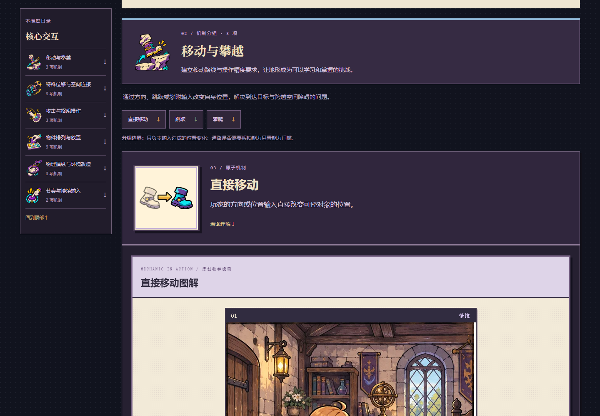

# 机制研究室 · Game Mechanics Atlas

**由魔魔王架设。** 面向游戏设计师的机制参考库：逐层查分类，对照游戏范例，查看机制关系，组合研究提示词。所有数据随站点提供，无需账号、数据库或模型 API。

A reference atlas for game designers, created by **魔魔王**. Explore mechanics, compare their use in real games, inspect relationships, and compose research prompts. Runs as a static site without an account, database, or model API.

[在线网站 / Website](https://momowangouo.github.io/game-mechanics-atlas/) · [分类参考 / Taxonomy](https://momowangouo.github.io/game-mechanics-atlas/taxonomy/) · [GitHub 点星支持 / Star](https://github.com/momowangOUO/game-mechanics-atlas) · [AI / Agent 资料入口](https://momowangouo.github.io/game-mechanics-atlas/for-agents/)




[操作录屏（MP4）](docs/mechanic-visuals/runtime/research-session.mp4) · [图标与漫画制作记录](docs/mechanic-visuals/README.md) · [全站文案修订](docs/copy-review/2026-11-01.md)

## 可以查什么

| 入口                                                                        | 内容                                                         |
| --------------------------------------------------------------------------- | ------------------------------------------------------------ |
| [分类参考](https://momowangouo.github.io/game-mechanics-atlas/taxonomy/)    | 9 个维度、50 个分组、122 条机制的定义、边界和游戏用法        |
| [游戏范例](https://momowangouo.github.io/game-mechanics-atlas/games/)       | 82 款游戏、718 条机制实例与 156 项来源，按模式和系统范围查阅 |
| [复合类型](https://momowangouo.github.io/game-mechanics-atlas/types/)       | 32 个类型的玩法过程、设计问题和相近类型区别                  |
| [机制模块关系图](https://momowangouo.github.io/game-mechanics-atlas/graph/) | 拖动、缩放、筛选维度，追踪相邻机制和相关游戏                 |
| [研究提示词](https://momowangouo.github.io/game-mechanics-atlas/lab/)       | 32 组配方入口、3 种研究模板，可编辑、复制与下载 Markdown     |
| [游戏对比](https://momowangouo.github.io/game-mechanics-atlas/compare/)     | 对照两款游戏的机制、循环、资源和搜索资料                     |
| [搜索趋势](https://momowangouo.github.io/game-mechanics-atlas/heat/)        | 更新至 2026-11-02 的四地区近期游戏搜索、历史榜单及本地导入   |

122 项机制均配有独立图标、图像模型生成的三格漫画、规则示意图和真实游戏范例。50 个分组另有独立插画。支持 Ctrl/Cmd K 全局搜索、手机连续阅读和减少动态偏好。每次整页打开或刷新会展示品牌 Logo；站内切换不重复播放。

选择分类维度后，整页展示该维度的所有分组、机制、图解和游戏用法。分组目录用于跳转位置，不隐藏内容；桌面与手机都可直接向下阅读三格漫画及规则图。机制图标以大方框呈现，漫画每格最大显示为 600 像素。游戏与对比页同样按章节连续展开，目录、搜索结果和排行榜不再分页；研究提示词保留四个编写步骤。[连续阅读与分组插画](docs/continuous-reading/README.md)

游戏机制总览按维度列出全部已收录机制，并保留不同模式与成立条件；聚焦机制不会隐藏其他方向。[游戏机制总览](docs/reader-overview/README.md)

分类实例带有游戏、模式、系统或章节等范围，并区分存在、不存在、不适用、未知和有条件成立。编辑分析与来源事实分别标记。搜索页先展示 2026-11-02 的 Google Trending Now 近期快照：四个地区、38 个已核对的电子游戏词条；2025 年榜单保留为历史资料。搜索量档位不当作精确次数，游戏搜索也不分摊为机制需求。[分类说明](docs/data-contract.md) · [搜索口径](docs/heat-method.md) · [资料来源](docs/real-search-demand.md) · [收录范围](docs/content-scope.md)

分类页与全站搜索支持复合类型、常用别名和分词查询，优先显示名称匹配。手机端目录和漫画采用自然滚动；游戏循环图在桌面形成闭合回路，手机按步骤竖排。

[搜索与手机体验更新](docs/search-mobile-update/README.md) · [2026 年游戏补充](docs/research/2026-game-update.md)

## 本地运行

需要 Node.js 24 与 npm，本轮使用 Node.js 24.11.1 验证。

```sh
npm ci
npm run dev
```

打开 [http://127.0.0.1:3000](http://127.0.0.1:3000)。静态构建与预览：

```sh
npm run build
npm start
```

GitHub Pages 项目子路径使用：

```sh
npm run build:pages
npm run preview:pages
```

访问 [http://127.0.0.1:3000/game-mechanics-atlas/](http://127.0.0.1:3000/game-mechanics-atlas/)。构建输出为 `out/`；根路径和项目子路径使用各自构建配置。详细部署步骤见 [静态部署说明](docs/static-pages-implementation.md)。

## AI / Agent 读取

[AI / Agent 资料入口](https://momowangouo.github.io/game-mechanics-atlas/for-agents/) 汇总站点阅读方式、[llms.txt](https://momowangouo.github.io/game-mechanics-atlas/llms.txt) 与数据导出入口。引用机制或游戏分析时保留页面、范围与原始来源；数据字段以[实体契约](docs/data-contract.md)为准。

## 参与和反馈

欢迎在 [Issues](https://github.com/momowangOUO/game-mechanics-atlas/issues) 提交更正、补充来源或提出使用问题。内容更正请附页面地址、具体机制及可核对的来源；代码修改请说明行为变化和验证方式。新增游戏实例需要保留规范机制 ID、发生范围、状态和成立条件。

主要验证命令：

```sh
npm run typecheck
npm test
npm run test:readlink
npm run test:static
npm run test:agent-data
npm run build
npm run test:e2e
```

浏览器测试使用 Playwright Chromium，可用 `PLAYWRIGHT_CHANNEL` 指定已安装的浏览器，或用 `PLAYWRIGHT_BASE_URL` 指向现有服务。[验收记录](docs/verification.md) · [发布记录](docs/publication.md)

## 署名与素材

© 2026 魔魔王。原创文案、编辑整理、界面设计、品牌 Logo、原创角色与配套插画署名为魔魔王；游戏名称、商标、官方图像及第三方引用资料归各自权利人。详见 [版权与署名](COPYRIGHT.md) 及[游戏图源清单](src/data/game-art-sources.json)。

技术依赖包括 Next.js、React、TypeScript、Motion、XYFlow、Zod、Vitest 与 Playwright，版本固定于 `package-lock.json`，各依赖遵循自己的许可证。公开源码不等于对本站所有内容和资产授予统一许可。

历史制作资料：[视觉规范](.design-scout/design-direction.md) · [美术制作记录](docs/game-artist/upgrade.md) · [分类修订](docs/taxonomy-revision/implementation.md) · [品牌与开场说明](docs/brand.md)
