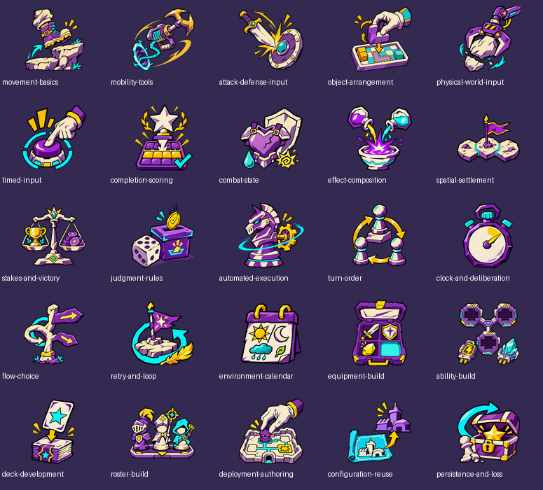
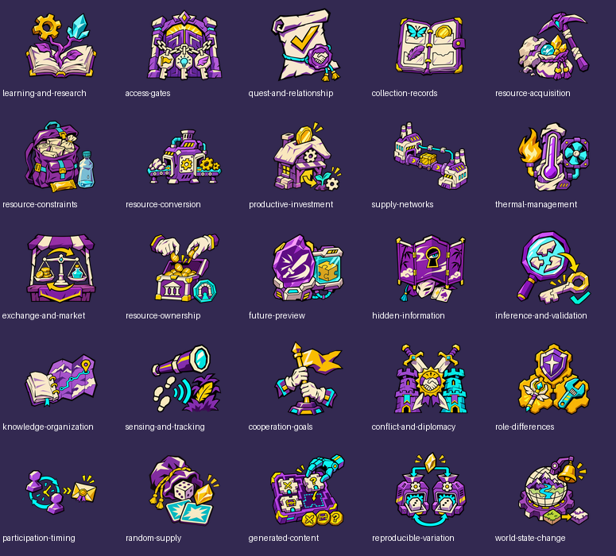

# 机制分组插画

这组插画用于帮助读者识别本站整理的 50 个机制分组。插画是编辑示意，不是游戏截图，也不为游戏实例提供事实证据。

## 制作依据

沿用项目中 `jump.webp`、`resource-scarcity.webp`、`loadout-selection.webp` 的物件插画方向：粗黑轮廓、略带棱角的造型、平涂与少量分层阴影，以奶油白、紫色、青色和黄色为主。每组使用能表达其含义的具体器具或物件组合，不用维度标记替代分组插画。

## 生成与处理

使用 Codex 内置 `image_gen` 工具，每个分组单独生成，修订时另行调用。完整的最终提示词见 [prompts.json](./prompts.json)。没有使用外部图像 API、CLI 生图、拼接精灵图或程序绘制替代模型插画。

提示词请求 512 × 512 透明图像；工具实际返回的尺寸由模型决定，原图保留在本机 Codex 生成目录。随后仅做等比缩放、透明留边和无损 WebP 转换，统一输出 512 × 512，保留真实透明通道。原图路径和本机映射只保存在忽略目录，不进入交付文档。

最终资源目录为 `public/art/taxonomy-groups/`，文件名使用既有分组 ID；显示映射为 `src/data/taxonomy-group-visuals.ts`，组件为 `src/components/TaxonomyGroupIcon.tsx`。组件默认以 96 像素正方形显示，也接受页面传入的其他尺寸。

`combat-state` 首版因风格约束缺失而出现写实金属质感，未作为最终素材。修订版补全了平涂、粗线和材质限制，并重新生成；原版及本机映射留在忽略目录和原始生成目录。其他分组各自独立生成，最终提示词只记录采用版本。

## 检查范围

资源完整性检查覆盖 50 个既有分组 ID、文件非空、WebP 真实尺寸、透明通道和文件内容唯一性。JSON 与 Markdown 导出保留原来的分组、维度和机制事实，只增加插画说明与地址。

视觉检查按 96 像素接触表逐项查看轮廓、区分度、透明边缘和既有画风的相容性。页面中的布局、手机显示与实际交互由本次界面验收另行检查。

最终 50 张图标的文件尺寸、透明通道与 SHA-256 记录见 [manifest.json](./manifest.json)。全部为 512 × 512 透明 WebP，合计 9,059,054 字节；文件内容各不相同。

2026-11-02 已完成全部 50 项的两张 96 像素接触表检查，并检查了替换后的 `combat-state` 单图。每个分组均有独立画面，已采用版本保持物件插画的粗轮廓和平涂方向。接触表和原图路径映射保存在忽略的本机构建目录。

最终 [manifest.json](./manifest.json) 记录各图实际源尺寸、透明通道检查、输出尺寸和 SHA-256。50 张源 PNG 均为 1254 × 1254 且有真实透明区域；最终文件均为 512 × 512 无损 WebP，共 9,059,054 字节，50 个文件哈希各不相同。此次共完成 51 次独立模型生成，包含弃用的 `combat-state` 首版。

`node --test scripts/export-agent-data.test.mjs` 的 7 项检查已通过，覆盖新增的 50 项插画完整性及既有 Agent 内容导出回归。
